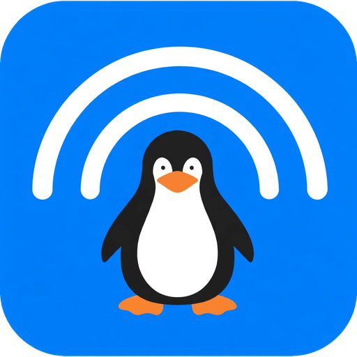
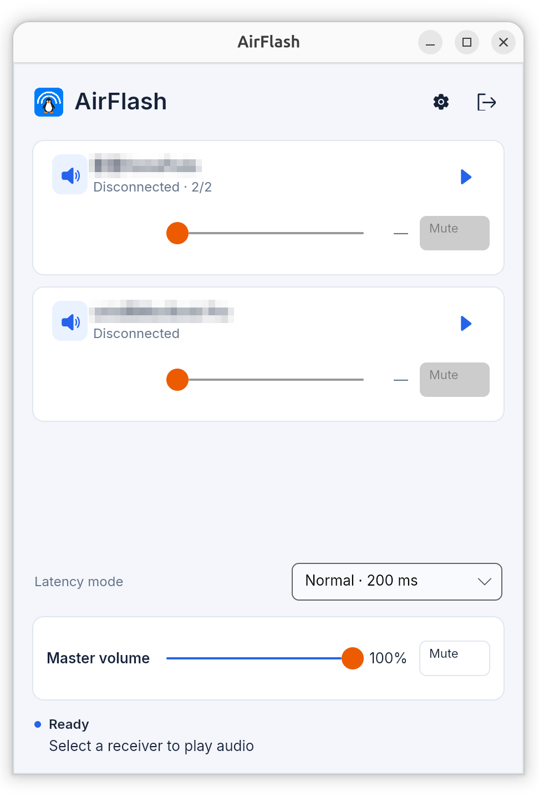

#  AirFlash Linux — Stream Linux Desktop Audio to HomePod over AirPlay 2

<p align="center">
  <a href="README.md">English</a> ·
  <a href="docs/README.zh-CN.md">简体中文</a>
</p>

<p align="center">
  <a href="https://github.com/yoruraven/AirFlash-Linux/releases/latest"></a>
  
  
  
</p>

<p align="center">
  
</p>

**AirFlash Linux is a native AirPlay 2 sender for Linux: it streams your Linux
desktop audio — any app, system-wide — to a HomePod, a HomePod mini, or an
existing HomePod stereo pair.** It is the Linux edition of
[AirFlash](https://github.com/Ding-Kyoma/AirFlash), reusing the same native
Rust AirPlay 2 engine as the Windows build, with a graphical panel, a headless
CLI, and system-audio capture through PipeWire (with a PulseAudio fallback).

If you are looking for a way to **use a HomePod as a speaker for your Linux
PC**, a **TuneBlade or Airfoil alternative for Linux**, or an **AirPlay 2
sender that is not a media server**, this is it: no library to import, no
server to run — pick a receiver and your desktop sound plays on the HomePod.

> **Sender, not receiver.** AirFlash Linux *sends* audio from Linux to an
> AirPlay 2 speaker. It is the opposite direction of Shairport Sync or UxPlay,
> which turn a Linux machine into an AirPlay *receiver*.

## Quick start

1. Download the `-full` AppImage for your architecture from
   [GitHub Releases](https://github.com/yoruraven/AirFlash-Linux/releases/latest):

   ```bash
   chmod +x AirFlash-X.Y.Z-x86_64-full.AppImage
   ./AirFlash-X.Y.Z-x86_64-full.AppImage   # opens the graphical panel
   ```

   No installation or root access is needed: the AppImage is a single
   self-contained file with the panel, the CLI, the engine and the .NET
   runtime inside. The AppImage is not code-signed; verify it against the
   release's `SHA256SUMS.txt`.

2. Make sure the PC and the HomePod are on the same local network, open
   AirFlash, and wait for the receiver list to populate.

3. Select the receiver (or the complete `HomePod stereo · 2/2` entry for a
   stereo pair) and press play. In **Settings → Audio source**, choose system
   audio to stream your desktop sound.

Prefer a terminal? The same AppImage drives the headless CLI — any CLI
command runs the headless binary instead of the panel:

```bash
./AirFlash-X.Y.Z-x86_64-full.AppImage discover
./AirFlash-X.Y.Z-x86_64-full.AppImage start --device "HomePod" --source loopback
```

Or with a separately installed `airflash-cli`:

```bash
airflash-cli discover                                   # find receivers (mDNS)
airflash-cli pair --host <receiver-ip>                  # only if a PIN is requested
airflash-cli start --host <receiver-ip> --source loopback --daemon
airflash-cli status
airflash-cli stop
```

See [docs/LINUX.md](docs/LINUX.md) for dependencies, the systemd `--user`
units, the full command reference and the PTP port setup described below,
and [docs/HEADLESS.md](docs/HEADLESS.md) for the headless CLI package.

## Features

- **Native AirPlay 2 streaming** — the same Rust sender as the Windows build:
  HAP pairing, PTP timing, encrypted RTP, PCM and ALAC (ALAC preferred, with
  an automatic codec retry — HomePods reject PCM-only setups).
- **Real audio capture on Linux** — `--source loopback` captures the
  default PipeWire sink monitor through explicitly linked monitor ports (the
  microphone is never picked up by name matching); on PulseAudio-only hosts it
  falls back to `parec`. `--monitor NAME` — or the capture-device picker in
  **Settings → Audio source** — selects any other capture device: another
  sink's monitor, or a source recorded directly, such as a microphone, a USB
  audio input or a Bluetooth A2DP source.
- **HomePod and HomePod stereo pairs** — single receivers and existing
  two-device stereo pairs, including per-receiver volume — **now with
  support for HomePod OS 26** (AirPlay 2).
- **Graphical panel and headless CLI** — an Avalonia panel sharing the Windows
  build's core (receiver list, equalizer, diagnostics, settings), plus a
  scriptable `airflash-cli` with daemon mode, JSON output and
  `systemd --user` units. A slim `-cli.tar.gz` package (engine + CLI +
  units only, built for glibc 2.35+) runs the CLI on headless machines
  such as a Raspberry Pi.
- **Latency controls** — Real-time (120 ms target), Normal (200 ms, default),
  Buffered and Custom modes, with an optional forced fixed latency. Targets
  are scheduling values, not measured end-to-end acoustic latency.
- **Ten-band equalizer** with presets and live preview, automatic
  reconnection, silence standby (release the session when quiet, resume when
  audio returns), and detailed connection diagnostics.
- **Self-contained AppImages** for Linux x86_64 and arm64 — no .NET,
  Python or other runtime to install. The arm64 build is not
  hardware-qualified yet.
- English and Simplified Chinese UI.

## More ways to play

- **A Raspberry Pi as an always-on streamer.** Install the `-cli` package
  on a headless Pi, enable the shipped systemd user unit, and point any
  player on the Pi (MPD, mopidy, a browser) at its output — the Pi becomes
  a dedicated AirPlay sender for the HomePod.
- **Give the HomePod a Bluetooth input.** Pair a phone with the Linux
  machine (BlueZ + PipeWire) and the phone appears as a Bluetooth capture
  source: pick it, and whatever the phone plays comes out of the HomePod.
- **Microphones and USB inputs.** A microphone makes a simple announcement
  or intercom feed; a USB turntable or a mixer through a USB sound adapter
  turns any line-level source into an AirPlay source.
- **Announcements from scripts.** Generate a WAV (for example with a local
  TTS) and play it through the file source — a natural fit next to Home
  Assistant on the same box.

## Tested on real hardware

Claims above are qualified on hardware, not only against simulated
receivers. Summary (last updated November 2026):

| Environment | Receiver | Audio source | Result |
| --- | --- | --- | --- |
| Linux · x86_64 · PipeWire | HomePod mini | System audio (PipeWire monitor), WAV file, simulated signal | ✅ End-to-end playback (ALAC 44.1 kHz), clean receiver feedback |
| Ubuntu 26.04 LTS · x86_64 · GNOME · PipeWire | HomePod stereo pair (full-size HomePods) | Simulated signal, system audio (desktop capture) | ✅ End-to-end playback, thousands of packets with zero send errors |
| Ubuntu 26.04 LTS · x86_64 | Localhost / simulated receivers | Automated Rust, .NET and Python test suites | ✅ Passing |
| aarch64 (build only) | — | — | ⚠️ Builds with the packaging script; not yet qualified on hardware |

Other glibc-based distributions should work — the runtime needs little more
than glibc and PipeWire or PulseAudio — but only the environment above is
hardware-tested. Reports from other distributions are very welcome.
Separately, capture from a real PipeWire source (a machine's analog
microphone input) is verified at the capture layer; end-to-end playback
from microphone, USB and Bluetooth sources has not been hardware-qualified
yet.

## How it compares

| | AirFlash Linux | OwnTone | Shairport Sync | TuneBlade |
| --- | --- | --- | --- | --- |
| Direction | **Sender** (Linux → speaker) | Sender (media server) | Receiver (speaker → Linux) | Sender (Windows → speaker) |
| Sends live desktop audio | ✅ Any app, system-wide | Via file/FIFO plumbing | — | ✅ |
| AirPlay 2 to HomePod | ✅ Native | ✅ | Receives AirPlay 2 | ❌ AirPlay 1 only |
| Graphical panel + CLI | ✅ Both | Web UI / API | ❌ | ✅ Windows only |
| Runs on Linux | ✅ | ✅ | ✅ | ❌ |

## Usage notes

- **Pairing.** Most receivers pair transparently; if a receiver requests a
  PIN, pair once via the panel (**Settings → Receivers**) or
  `airflash-cli pair`. If pairing fails with `pairing rejected (TLV error
  [2])`, open the Home app, set speaker access to **Everyone**, and try again.
- **PTP timing uses ports 319/320.** PTP is preferred for tightly synced
  AirPlay 2 playback, but UDP 319/320 are privileged ports. If they cannot
  be bound, the engine warns and falls back to NTP timing instead of
  failing the stream. For full PTP sync, grant access once with
  `sudo setcap cap_net_bind_service=+ep` on the binary, by lowering
  `net.ipv4.ip_unprivileged_port_start`, or via the `AmbientCapabilities`
  line in the shipped systemd unit.
- **Same network, no NAT in between.** The receiver must be able to send UDP
  back to this host; bridged networking works, NATed VM guests generally do
  not. See [PTP startup troubleshooting](docs/PTP-TROUBLESHOOTING.md).

## Limitations

- Audio only: no screen mirroring or video, and no Dolby Atmos.
- Per-application capture is currently a Windows feature. On Linux you can
  capture any sink monitor or source device, but not a single app's stream
  (route the app to a dedicated sink if you need it isolated).
- Discovery uses a built-in minimal mDNS querier: no continuous browsing and
  no IPv6 link-local answers.
- The tray icon is not available on every desktop environment.
- Capture, resampling and format conversion do not guarantee bit-perfect
  output, and capture of DRM-protected content is not guaranteed.
- AppImages are not code-signed; verify `SHA256SUMS.txt`.

## FAQ

**Can I use a HomePod as the speaker for my Linux PC?**
Yes — that is exactly what AirFlash Linux does. It captures your desktop
audio (PipeWire or PulseAudio) and streams it to a HomePod or HomePod mini
over AirPlay 2.

**Does it work with a HomePod stereo pair?**
Yes. Existing two-device stereo pairs appear as one `2/2` entry and play in
sync. Experimental software stereo groups for two separate receivers are
also in the shared engine; they are not yet hardware-qualified on Linux.

**Is this an AirPlay receiver for Linux?**
No. Receivers (Shairport Sync, UxPlay) make Linux *appear as* a speaker.
AirFlash Linux is a *sender*: Linux is the source, the HomePod is the
speaker.

**Do I need PipeWire?**
PipeWire is the primary path (any current distribution). On PulseAudio-only
hosts, capture falls back to `parec`. Audio capture does not depend on your
compositor, so it works the same under Wayland and X11 sessions.

**How is this different from OwnTone?**
OwnTone is a media server: it streams a music library you give it. AirFlash
Linux captures the live output of your whole desktop — browser, player,
calls, games — and sends it directly, with a desktop panel and a CLI, and no
server to configure.

**What latency should I expect?**
The Real-time profile targets 120 ms of scheduling latency, which suits
music and desktop use. End-to-end acoustic latency also depends on the
receiver and the network and is not measured by the app, so competitive
gaming is not the target use case.

## Stack

- **Rust** — the native AirPlay 2 engine: system-audio capture on Linux
  (PipeWire / PulseAudio monitor), AirPlay 2 sessions, HAP pairing, PTP,
  RTP and audio transport
- **C# / .NET 10** — shared `AirFlash.Core` (session control, settings,
  receiver catalog, equalizer, localization)
- **Avalonia** — the Linux graphical panel (`desktop/AirFlash.UI`); the
  Windows build uses WPF on the same core
- **Built-in mDNS querier** on Linux for receiver discovery (Avahi/Bonjour
  not required)
- **PCM and ALAC** with encrypted RTP for HomePod playback

## Build from source

Requirements: Rust stable 1.85+, .NET SDK 10.0+ (for the panel), and
`pw-record` (PipeWire) or `parec` (PulseAudio) at runtime.

```bash
# Headless CLI + engine
cargo build --release --features cli --manifest-path native/airflash-engine/Cargo.toml

# Graphical panel
dotnet build desktop/AirFlash.UI/AirFlash.UI.csproj

# AppImage (backend, or VARIANT=full for the panel edition)
packaging/linux/appimage/build-appimage.sh
```

Tests:

```bash
cargo test --features cli --manifest-path native/airflash-engine/Cargo.toml
dotnet test desktop/AirFlash.Tests/AirFlash.Tests.csproj
dotnet test desktop/AirFlash.UI.Tests/AirFlash.UI.Tests.csproj
uv run pytest
```

Full Linux build, packaging and systemd details: [docs/LINUX.md](docs/LINUX.md).

## Relationship to upstream

AirFlash Linux is a fork of [Ding-Kyoma/AirFlash](https://github.com/Ding-Kyoma/AirFlash)
(the Windows edition) and tracks upstream releases — the shared engine and
core improvements flow in both directions where they are platform-neutral.
This repository is where the Linux packaging, the Avalonia panel, the Linux
capture path and Linux releases live. Windows installation and usage are
documented in the upstream repository.

## Contributing

Pull requests are welcome — especially hardware reports from other
distributions, desktop environments and receiver models. Please keep
protocol behavior, pairing boundaries and measurement limits explicit in
changes, and state clearly what was tested on real hardware versus simulated
receivers.

## License

[GPLv3+](LICENSE-GPLv3) or [Commercial License](LICENSE-COMMERCIAL.md).
