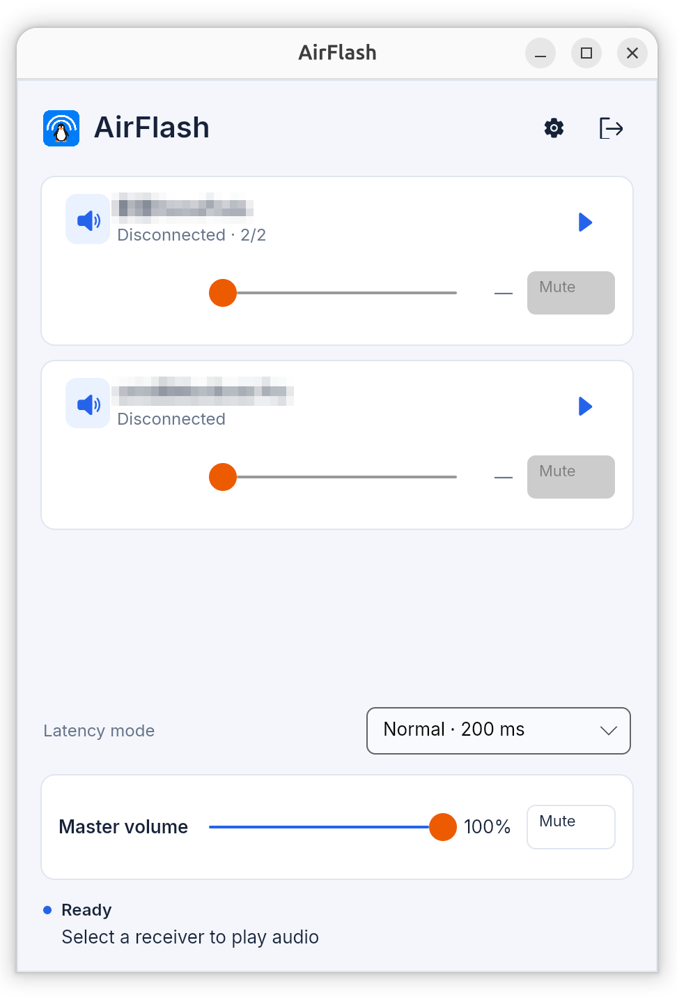

#  AirFlash Linux — 把 Linux 桌面声音投到 HomePod（AirPlay 2）

<p align="center">
  <a href="../README.md">English</a> ·
  <a href="README.zh-CN.md">简体中文</a>
</p>

<p align="center">
  <a href="https://github.com/yoruraven/AirFlash-Linux/releases/latest"></a>
  
  
  
</p>

<p align="center">
  
</p>

**AirFlash Linux 是一个原生 AirPlay 2 发送端：它把 Linux 桌面声音——任何
应用、全系统——投送到 HomePod、HomePod mini，或已有的 HomePod 立体声组合。**
它是 [AirFlash](https://github.com/Ding-Kyoma/AirFlash) 的 Linux 版，与
Windows 版共用同一套原生 Rust AirPlay 2 引擎，提供图形面板和无头 CLI，
系统声音采集走 PipeWire（PulseAudio 可回退）。

如果你在找的是「**让 HomePod 当 Linux 电脑的音箱**」「**Linux 上的
TuneBlade / Airfoil 替代品**」或者「**不用搭媒体服务器的 AirPlay 2
发送端**」，就是它：不用导入曲库、不用跑服务器，选好接收端，桌面声音
就在 HomePod 上响。

> **它是发送端，不是接收端。** AirFlash Linux 把声音从 Linux *发* 到
> AirPlay 2 音箱；Shairport Sync、UxPlay 是反过来的方向，它们把 Linux
> 变成 AirPlay *接收端*。

## 快速开始

1. 从 [GitHub Releases](https://github.com/yoruraven/AirFlash-Linux/releases/latest)
   下载对应架构的 `-full` AppImage：

   ```bash
   chmod +x AirFlash-X.Y.Z-x86_64-full.AppImage
   ./AirFlash-X.Y.Z-x86_64-full.AppImage   # 打开图形面板
   ```

   无需安装、无需 root：AppImage 是单个自包含文件，面板、CLI、引擎和
   .NET 运行时都在里面。AppImage 没有代码签名，请用发布附带的
   `SHA256SUMS.txt` 核对文件。

2. 确认电脑和 HomePod（系统版本为 HomePod OS 26 或以上）在同一局域网，
   打开 AirFlash，等接收端列表出现。

3. 选择接收端（立体声组合选完整的 `HomePod stereo · 2/2` 一项）并点
   播放；在 **设置 → 音频来源** 里选系统声音，即可投送桌面声音。

习惯用终端也可以：同一个 AppImage 带无头 CLI，传任何 CLI 命令时运行的
就是无头程序而不是面板：

```bash
./AirFlash-X.Y.Z-x86_64-full.AppImage discover
./AirFlash-X.Y.Z-x86_64-full.AppImage start --device "HomePod" --source loopback
```

或使用单独安装的 `airflash-cli`：

```bash
airflash-cli discover                                   # 发现接收端（mDNS）
airflash-cli pair --host <接收端IP>                      # 仅当设备要求 PIN 时需要
airflash-cli start --host <接收端IP> --source loopback --daemon
airflash-cli status
airflash-cli stop
```

依赖、systemd `--user` 服务、完整命令参考和下文提到的 PTP 端口设置，
见 [LINUX.md](LINUX.md)（英文）。

## 主要功能

- **原生 AirPlay 2 发送**——与 Windows 版共用同一套 Rust 引擎：HAP 配对、
  PTP 时钟、加密 RTP、PCM 与 ALAC（优先 ALAC，被拒时自动换编码重试；
  HomePod 会拒绝只用 PCM 的建立方式）。
- **Linux 桌面声音真采集**——`--source loopback` 通过显式连接的 monitor
  端口采集默认 PipeWire 输出的监听流（不会靠名字模糊匹配误抓麦克风）；
  只有 PulseAudio 的机器回退到 `parec`。`--monitor NAME` 可换另一个
  输出设备。
- **支持 HomePod 与立体声组合**——单个接收端和已有的双 HomePod 立体声
  组合，每台设备可单独调音量；**支持 HomePod OS 26 及以上版本**
  （AirPlay 2）。
- **图形面板 + 无头 CLI**——Avalonia 面板与 Windows 版共用核心（接收端
  列表、均衡器、诊断、设置），另有可脚本化的 `airflash-cli`：守护进程
  模式、JSON 输出、 `systemd --user` 服务文件。
- **延迟可控**——实时（目标 120 ms）、正常（200 ms，默认）、缓冲和自定义
  模式，可选强制固定延迟。注意这些是调度目标值，不是实测的端到端声学
  延迟。
- **10 段均衡器**（预设 + 即时试听）、自动重连、静音待机（安静时释放
  会话、有声音时自动恢复）、详细的连接诊断。
- **自包含 AppImage**（Linux x86_64）——不用另装 .NET、Python 或其他
  运行时。aarch64 可用同一脚本构建，但尚未做实机验收。
- 界面支持英文和简体中文。

## 实测矩阵

以下结论都在真实硬件上验证过，不只是对模拟接收端跑通。汇总（最近更新：
2026 年 11 月）：

| 环境 | 接收端 | 声音来源 | 结果 |
| --- | --- | --- | --- |
| Linux · x86_64 · PipeWire | HomePod mini | 系统声音（PipeWire 监听）、WAV 文件、模拟信号 | ✅ 端到端出声（ALAC 44.1 kHz），接收端反馈正常 |
| Ubuntu 26.04 LTS · x86_64 · GNOME · PipeWire | HomePod 立体声组合（全尺寸 HomePod） | 模拟信号、系统声音（桌面采集） | ✅ 端到端出声，数千个包零发送错误 |
| Ubuntu 26.04 LTS · x86_64 | 本机 / 模拟接收端 | Rust、.NET、Python 自动化测试套件 | ✅ 全部通过 |
| aarch64（仅构建） | — | — | ⚠️ 打包脚本可构建，尚未实机验收 |

其他基于 glibc 的发行版理论上都能跑——运行时只需要 glibc 和 PipeWire
或 PulseAudio——但目前只有上表环境做过实机验证。非常欢迎其他发行版的
实测报告。

## 和同类方案的区别

| | AirFlash Linux | OwnTone | Shairport Sync | TuneBlade |
| --- | --- | --- | --- | --- |
| 方向 | **发送端**（Linux → 音箱） | 发送端（媒体服务器） | 接收端（音箱 → Linux） | 发送端（Windows → 音箱） |
| 投送实时桌面声音 | ✅ 任何应用、全系统 | 要靠文件/FIFO 喂流 | — | ✅ |
| AirPlay 2 投 HomePod | ✅ 原生 | ✅ | 接收 AirPlay 2 | ❌ 只有 AirPlay 1 |
| 图形面板 + CLI | ✅ 两者都有 | Web 界面 / API | ❌ | ✅ 仅 Windows |
| 能在 Linux 上跑 | ✅ | ✅ | ✅ | ❌ |

## 使用说明

- **配对。** 多数接收端可直接透明配对；设备要求 PIN 时，在面板
  （**设置 → 接收器**）或用 `airflash-cli pair` 配对一次即可。如果出现
  `pairing rejected (TLV error [2])`，请在「家庭」App 里把扬声器访问
  权限设为「所有人」后重试。
- **PTP 需要 319/320 端口。** HomePod 等 AirPlay 2 接收端要求 PTP 时钟，
  而 UDP 319/320 是特权端口：给二进制加一次
  `sudo setcap cap_net_bind_service=+ep`、调低
  `net.ipv4.ip_unprivileged_port_start`、或用随附 systemd 服务里的
  `AmbientCapabilities` 行，三选一即可。没有 PTP 时会话能连上、但接收端
  会拒绝音频流。`--timing auto`（默认）被迫回退时会明确告警。
- **同一网络、中间不要有 NAT。** 接收端要能用 UDP 回连本机；桥接网络
  可以，NAT 模式的虚拟机一般不行。见
  [PTP 启动排障](PTP-TROUBLESHOOTING.md)（英文）。

## 已知限制

- 只做音频：不支持屏幕镜像/视频，不支持杜比 Atmos。
- 按应用采集目前是 Windows 版功能；Linux 上采集的是全系统输出监听流
  （需要隔离某个应用时，可先把它的输出路由到独立的输出设备再选
  `--monitor`）。
- 发现功能用的是内置的精简 mDNS 查询器：不支持持续浏览，不回答
  IPv6 link-local。
- 托盘图标不是在所有桌面环境上都有。
- 采集、重采样和格式转换不保证逐位无损，也不保证能采集受 DRM 保护的
  内容。
- AppImage 没有代码签名，请核对 `SHA256SUMS.txt`。

## 常见问题

**能让 HomePod 当 Linux 电脑的音箱吗？**
可以，这正是 AirFlash Linux 的用途：它采集桌面声音（PipeWire 或
PulseAudio），通过 AirPlay 2 投到 HomePod 或 HomePod mini。

**支持 HomePod 立体声组合吗？**
支持。已有的双设备立体声组合会显示为一个 `2/2` 条目，同步播放。
共享引擎里还有实验性的双接收端软件立体声，Linux 上尚未做实机验收。

**它是 Linux 上的 AirPlay 接收端吗？**
不是。接收端（Shairport Sync、UxPlay）是把 Linux *变成* 一个音箱；
AirFlash Linux 是 *发送端*：Linux 是声源，HomePod 才是音箱。

**必须用 PipeWire 吗？**
PipeWire 是主路径（当前主流发行版都是它）；只有 PulseAudio 的机器会
回退到 `parec`。声音采集不依赖合成器，Wayland 和 X11 会话下行为一致。

**和 OwnTone 有什么区别？**
OwnTone 是媒体服务器，播的是你给它的曲库文件；AirFlash Linux 采集的是
整个桌面的实时输出——浏览器、播放器、通话、游戏——直接发送，带桌面
面板和 CLI，不需要配置服务器。

**延迟怎么样？**
实时模式的目标调度延迟是 120 ms，听音乐和日常桌面使用足够；端到端
声学延迟还取决于接收端和网络状况，应用本身不做测量，所以它不适合
竞技游戏这类场景。

## 技术栈

- **Rust**——原生 AirPlay 2 引擎：Linux 系统声音采集（PipeWire /
  PulseAudio 监听）、AirPlay 2 会话、HAP 配对、PTP、RTP 与音频传输
- **C# / .NET 10**——共享的 `AirFlash.Core`（会话控制、设置、接收端
  目录、均衡器、本地化）
- **Avalonia**——Linux 图形面板（`desktop/AirFlash.UI`）；Windows 版在
  同一核心上使用 WPF
- **内置 mDNS 查询器**——Linux 上的接收端发现（不依赖 Avahi/Bonjour）
- **PCM 与 ALAC**——通过加密 RTP 发送到 HomePod

## 从源码构建

需要：Rust stable 1.85+、.NET SDK 10.0+（构建面板时）、运行时有
`pw-record`（PipeWire）或 `parec`（PulseAudio）。

```bash
# 无头 CLI + 引擎
cargo build --release --features cli --manifest-path native/airflash-engine/Cargo.toml

# 图形面板
dotnet build desktop/AirFlash.UI/AirFlash.UI.csproj

# AppImage（backend，或 VARIANT=full 构建带面板的版本）
packaging/linux/appimage/build-appimage.sh
```

测试：

```bash
cargo test --features cli --manifest-path native/airflash-engine/Cargo.toml
dotnet test desktop/AirFlash.Tests/AirFlash.Tests.csproj
dotnet test desktop/AirFlash.UI.Tests/AirFlash.UI.Tests.csproj
uv run pytest
```

Linux 构建、打包与 systemd 的完整说明见 [LINUX.md](LINUX.md)（英文）。

## 与上游的关系

AirFlash Linux 是 [Ding-Kyoma/AirFlash](https://github.com/Ding-Kyoma/AirFlash)
（Windows 版）的 fork，持续跟进上游版本——共享引擎和核心的改进在平台
无关的部分双向流动。本仓库维护 Linux 打包、Avalonia 面板、Linux 采集
路径和 Linux 发布；Windows 版的安装与使用见上游仓库。

## 参与贡献

欢迎 PR——尤其是其他发行版、桌面环境和接收端型号的实测报告。提交时
请写清协议行为、配对边界和测量限制，并注明哪些是在真实硬件上测的、
哪些只是对模拟接收端测的。

## 许可证

[GPLv3+](../LICENSE-GPLv3) 或 [商业授权](../LICENSE-COMMERCIAL.md)。
